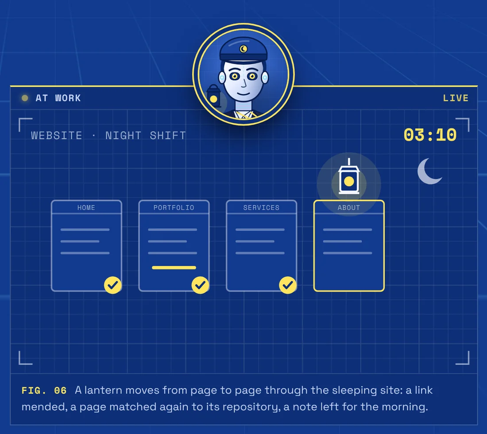
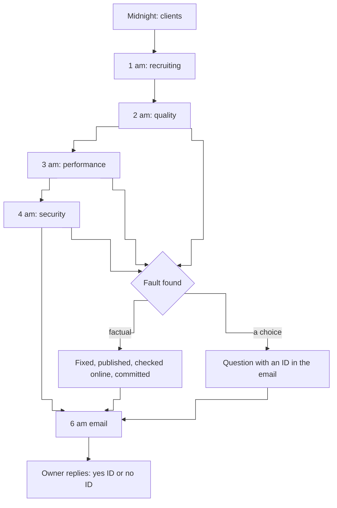
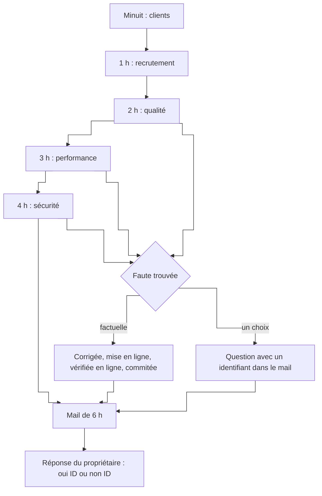

# Agent - Website night shift

Every night, five agents go over the website one after the other: quality, performance, security, and two that look for who it could help.

**English** · [Français](#version-française)

> Showcase repository: the code and data of this project are private; this README describes it.

*The site sleeps, we don't.*

## What it does

- **Replays every user story, desktop and phone.** The quality agent replays every user story of the site's design mock-up in a real browser, and opens every project page in both languages.
- **Checks every project page against its repository** on GitHub.
- **Tracks weight, speed and security night after night.** The performance agent keeps the figures from one night to the next: a number that gets worse is a fault even if it is still "fine". The security agent checks headers, certificates, libraries and that no personal data leaks into public pages or repositories.
- **Sums it all up in the 6 am email**: what was fixed, and the choices left to the owner.

The two other agents, clients and recruiting, only prepare: who might be interested and what could be published. They contact nobody.

It is meant for someone who runs a website alone and wants it to stay right without spending evenings on it.

## How it works

- **One agent per night slot**, on a home machine, each with its own written mission and its own memory of past nights.
- **What an agent may do alone**: factual, mechanical fixes (a broken link, a wrong "Live: No", a missing header). It publishes, checks the result online on desktop and phone, and commits with the reason. A fix it cannot see working online is rolled back.
- **What it only proposes**: wording, design, anything that is the owner's choice. Replying "yes ID" or "no ID" to the morning email is the whole review.
- **Effort is counted, not declared**: a script reads each agent's session afterwards (actions really taken, pages opened, user stories cited, repositories checked). Below the floor, the agent is sent back to finish what is missing.

## First night

In service since 9 November 2026. First night: 142 page views checked with no JavaScript error, 46 of 47 user stories conforming after one fix, 30 project pages checked in both languages, 3 fixes published (phone back button, sitemap, a wrong "Live" field); HTTPS enforced and a content security policy added; fonts served by the site itself instead of a third party.

## What it runs on

On a home machine, from midnight to 5 am: one headless Claude Code agent per slot, Playwright for the browser. The missions, memories and reports describe a private setup and are not published, so there is nothing to install from this repository.

- Claude Code agents, run headless on a schedule
- Playwright (real browser, desktop and phone)
- Python (effort counter, morning email, reading the replies)
- nginx, git

## Its page

- English: <https://ingevision.cloud/en/ai-agents/?p=agent-equipe-de-nuit>
- Français : <https://ingevision.cloud/agents-ia/?p=agent-equipe-de-nuit>

---

## Version française

# Agent - Équipe de nuit du site

Chaque nuit, cinq agents passent l'un après l'autre sur le site : qualité, performance, sécurité, et deux qui cherchent à qui il peut servir.

> Dépôt vitrine : le code et les données de ce projet sont privés ; ce README le décrit.

*Le site dort, pas nous.*

### Ce qu'il fait

- **Rejoue chaque user story, ordinateur et téléphone.** L'agent qualité rejoue chaque user story de la maquette du site dans un vrai navigateur, et ouvre chaque fiche dans les deux langues.
- **Compare chaque fiche à son dépôt** GitHub.
- **Mesure poids, vitesse et sécurité nuit après nuit.** L'agent performance garde les chiffres d'une nuit à l'autre : un chiffre qui se dégrade est une faute, même s'il reste « correct ». L'agent sécurité contrôle les en-têtes, les certificats, les bibliothèques, et qu'aucune donnée personnelle ne fuit dans les pages ou les dépôts publics.
- **Résume tout dans le mail de 6 h** : ce qui a été corrigé, et les choix qui reviennent au propriétaire.

Les deux autres agents, clients et recrutement, préparent seulement : qui pourrait être intéressé, ce qu'on pourrait publier. Ils ne contactent personne.

Il sert à une personne seule qui tient un site et veut qu'il reste juste sans y passer ses soirées.

### Comment il marche

- **Un agent par créneau de nuit**, sur une machine à la maison, chacun avec sa mission écrite et sa mémoire des nuits passées.
- **Ce qu'un agent fait seul** : les corrections factuelles et mécaniques (lien cassé, « En ligne : Non » faux, en-tête manquant). Il met en ligne, vérifie le résultat en ligne sur ordinateur et téléphone, puis commite avec la raison. Une correction qu'il ne voit pas marcher en ligne est défaite.
- **Ce qu'il propose seulement** : un texte, le design, tout ce qui est un choix du propriétaire. Répondre « oui ID » ou « non ID » au mail du matin suffit.
- **L'effort est compté, pas déclaré** : un script relit la session de chaque agent (actions faites, pages ouvertes, user stories citées, dépôts vérifiés). Sous le plancher, l'agent est relancé sur ce qui manque.

### Première nuit

En service depuis le 9 novembre 2026. Première nuit : 142 vues de pages contrôlées sans erreur JavaScript, 46 user stories conformes sur 47 après une correction, 30 fiches vérifiées dans les deux langues, 3 corrections mises en ligne (retour arrière au téléphone, plan du site, un champ « En ligne » faux) ; HTTPS imposé et politique de sécurité du contenu ajoutée ; polices servies par le site lui-même au lieu d'un tiers.

### Où il tourne

Sur une machine à la maison, de minuit à 5 h : un agent Claude Code sans écran par créneau, Playwright pour le navigateur. Les missions, mémoires et rapports décrivent une installation privée et ne sont pas publiés : il n'y a rien à installer depuis ce dépôt.

- Agents Claude Code, lancés sans écran selon un horaire
- Playwright (vrai navigateur, ordinateur et téléphone)
- Python (compteur d'effort, mail du matin, lecture des réponses)
- nginx, git

### Sa fiche

- Français : <https://ingevision.cloud/agents-ia/?p=agent-equipe-de-nuit>
- English: <https://ingevision.cloud/en/ai-agents/?p=agent-equipe-de-nuit>

---

**Anthony Hunt** · [Agent page on ingevision.cloud](https://ingevision.cloud/en/ai-agents/?p=agent-equipe-de-nuit) · [LinkedIn](https://www.linkedin.com/in/anthony-hunt-3948a9196) · [GitHub profile](https://github.com/anthohunt) · anthony@ingevision.cloud
